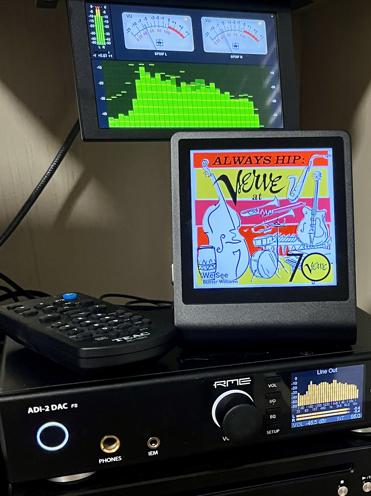
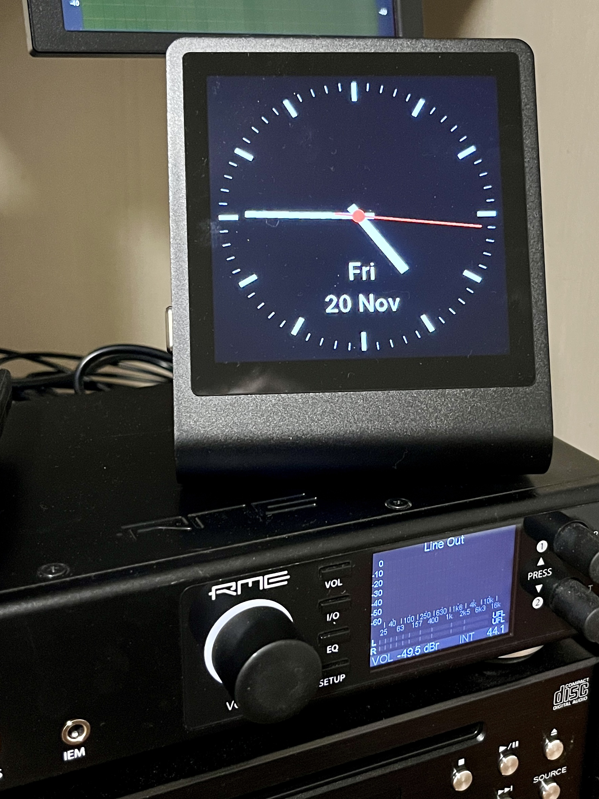

# Tune-Presto
Display Tune now playing on Pimoroni Presto
https://mozaiklabs.fr/

Load the two .py files into Thonny, edit secrets.py with your WiFi and Tune server info, test in Thonny, then push the two files to the Presto via Thonny.

